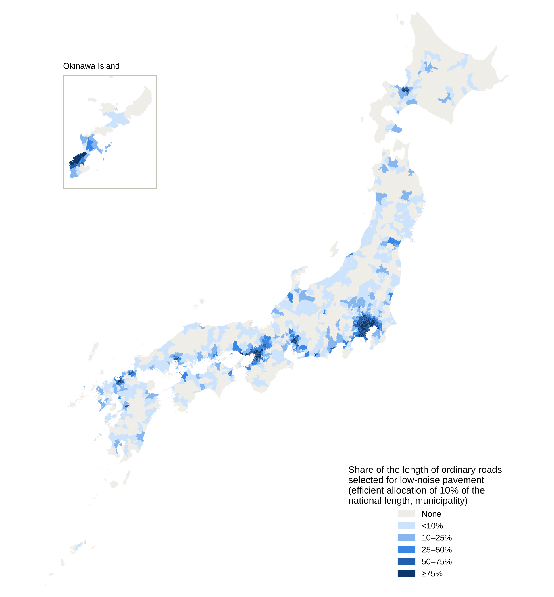

# Allocation of road traffic noise mitigation in Japan: sleep benefits and neighborhood disparities

Code and result files for the paper "Sleep benefits and neighborhood disparities in the allocation of road traffic noise mitigation in Japan" (Daisuke Matsushita, ORCID 0000-0002-6765-9366; submitted).

The study asks where a limited amount of low-noise pavement should be placed. It links nighttime road traffic noise at 12.3 million population-representative receptors, which cover the whole population of Japan, to the 94,112 census sections of ordinary roads, and compares ways of allocating the same treated length. It uses public data only.

<p align="center"></p>

*Share of the length of ordinary roads selected for low-noise pavement, by municipality, when 10% of the national length is treated under the efficient allocation. Interactive map with excess high sleep disturbance, the gap between neighborhoods and the equity-weighted allocation: https://m138.github.io/japan-road-noise-allocation/ . The inset shows Okinawa Island. Map lines delineate study areas and do not necessarily depict accepted national boundaries. Made by `src/webmap/make_readme_map.py`.*

> Status: the paper is under review. Data: https://doi.org/10.5281/zenodo.24503772 . Code (v1.0.0): https://doi.org/10.5281/zenodo.24504209 .

## Main results

- An estimated 1.52 million adults had excess high sleep disturbance from nighttime road traffic noise (95% interval 1.07–2.09 million). When neighborhoods were ranked by renter share within each municipality and pooled across the country, the rate in those with the highest renter shares was 1.71 times that in those with the lowest (17.4 versus 10.2 per 1,000 adults).
- With an assumed 3 dB source reduction, treating the 10% of road length with the largest reduction per unit length reduced excess high sleep disturbance by 22.1%. This is 75% of the benefit of treating all sections (29.6%) and more than seven times the benefit of the random allocation (2.9%).
- Weighting reductions in neighborhoods with higher renter shares (equity-weighted allocation, γ = 16) kept about 97% of the benefit of this efficient allocation (21.5% versus 22.1%), lowered the disparity ratio from 1.63 to 1.52 and the absolute gap from 5.2 to 4.5 per 1,000 adults. Selection by renter share alone gave a reduction of 14.1% and an absolute gap of 4.7.
- A simple rule that ranks sections by the adult population within 200 m per unit length obtained 95% of the benefit of the efficient allocation.

Figures 1–4 of the paper are in `figures/` (the sleep benefit and the disparity of each allocation are in `figures/Fig4.png`) and are made by `src/paper/make_figures_en.py`.

## Get the results (no need to run the model)

The data deposit on Zenodo (https://doi.org/10.5281/zenodo.24503772, CC BY 4.0) has two main files:

| File | One row per | Content |
|---|---|---|
| `small_area_burden_2020.csv` | 2020 census small area (`KEY_CODE`, 210,877 areas) | Population, renter share and its within-municipality quintile, areal deprivation index, housing type, excess high sleep disturbance, deaths attributable to near-road NO2 |
| `section_allocation.csv` | Census section of ordinary roads (94,112 sections) | Length, selection round under the efficient and equity-weighted allocations, benefit of the section alone, sections selected at 10% of road length |

The same deposit has `source_data/`, the result files behind every figure and supplementary table. These files are also in `data/` of this repository. Column definitions are in the README of the deposit.

## Reproduce the figures and tables from the result files

```
pip install -r requirements.txt
python src/paper/make_figures_en.py      # figures/Fig1-4 (.png, .eps)
python src/paper/build_si_tables.py      # src/paper/si_tables.md (Supplementary Tables 1-17)
python src/mc/mc_v5_summary.py           # summary of the 1,000 Monte Carlo runs (data/v5_mc_summary.csv)
```

These commands need only the files in `data/` and run in a few minutes. The scripts read and write under the current directory; set the environment variable `F_ROOT` to use another directory.

## Run the whole analysis

The full chain (noise energy matrix of receptors and sections, health burden, allocations, sensitivity and uncertainty analyses) is described in [PIPELINE.md](PIPELINE.md), with the order of the scripts, their arguments and the random seeds. The inputs and their terms of use are in [DATA_SOURCES.md](DATA_SOURCES.md). `MANIFEST_sha256.csv` gives the SHA-256 hash values of the input files and of the intermediate matrices of the run reported in the paper. Building the matrix takes about 10 minutes on 4 cores with 16 GB of memory.

The exposure estimates come from two earlier models, which are needed for a full run:

- nighttime road traffic noise: https://github.com/m138/japan-night-road-noise
- NO2: https://github.com/m138/japan-traffic-no2 (receptor file: https://doi.org/10.5281/zenodo.24299015)

## What the code does

1. Builds small-area indicators from the 2020 Population Census: renter share, areal deprivation index, age structure and housing type (`src/build_*.py`).
2. Computes, for each prefecture, the sparse matrix of nighttime sound energy that each census section of ordinary roads brings to each receptor (`src/noise_scen/noise_matrix.py`).
3. Estimates excess high sleep disturbance in adults (WHO exposure–response relationship, counterfactual 40 dB) and deaths attributable to near-road NO2, and their rates by within-municipality quintile of renter share (`src/burden_v3.py`, `src/fig2/fig2_v8.py`).
4. Allocates the measure to sections by sequential maximization of the marginal benefit per unit length, in steps of 1% of road length, with an equity weight γ on avoided cases in neighborhoods with higher renter shares (`src/targeted/greedy_alloc.py`).
5. Runs sensitivity analyses: budget units, continuous treatment units, pavement performance (ASJ RTN-Model 2018, rolling noise only), heavy-vehicle reduction, receptor placement on building land, corrections of model bias and a simple roadside-population rule (`src/targeted/`).
6. Propagates the uncertainty of exposure, exposure–response slope and pavement effect by Monte Carlo simulation with 1,000 runs (`src/mc/`).
7. Maps for this repository (`src/webmap/`): `muni_summary.py` sums the results of the two main allocations by municipality (`data/muni_allocation.csv`), `make_readme_map.py` draws the map above and `make_webmap_data.py` makes `docs/muni.geojson` for the interactive map in `docs/index.html`. The interactive map shows, by municipality, excess high sleep disturbance, the gap between neighborhoods with the highest and lowest renter shares, the share of road length selected and the reduction under the efficient and the equity-weighted allocation. These municipal values are not reported in the paper.

Comments in the code are in English. Some string constants are in Japanese because they are column names of the source tables (census and Road Traffic Census) or labels in result files.

## Main limitations

- The 3 dB reduction of the main analysis is an assumption; the reduction of low-noise pavement differs by pavement type and age. The share of the all-sections benefit obtained with 10% of road length and the loss from the equity weight are almost the same under every assumption tested.
- Renter share is an indicator of small areas, not of whether an individual lives in rented housing.
- Noise is estimated from the roads of the Road Traffic Census only, outdoors at a height of 4 m, without screening by buildings. Receptors represent the population of a small area and are not the positions of dwellings.
- The budget is measured as road length (or lane length and paved area); costs were not assessed.

## License

- Code: MIT License (LICENSE)
- Result files in `data/` and the Zenodo data deposit: CC BY 4.0. Please also credit the data sources listed in DATA_SOURCES.md.

## Citation

If you use the data or the code, please cite:

- Matsushita, D. Sleep benefits and neighborhood disparities in the allocation of road traffic noise mitigation in Japan: data. Zenodo https://doi.org/10.5281/zenodo.24503772 (2026).
- Matsushita, D. japan-road-noise-allocation: code for the allocation of road traffic noise mitigation in Japan (v1.0.0). Zenodo https://doi.org/10.5281/zenodo.24504209 (2026).

The citation of the paper will be added when it is published.

日本語の説明は [README_ja.md](README_ja.md) にあります。
