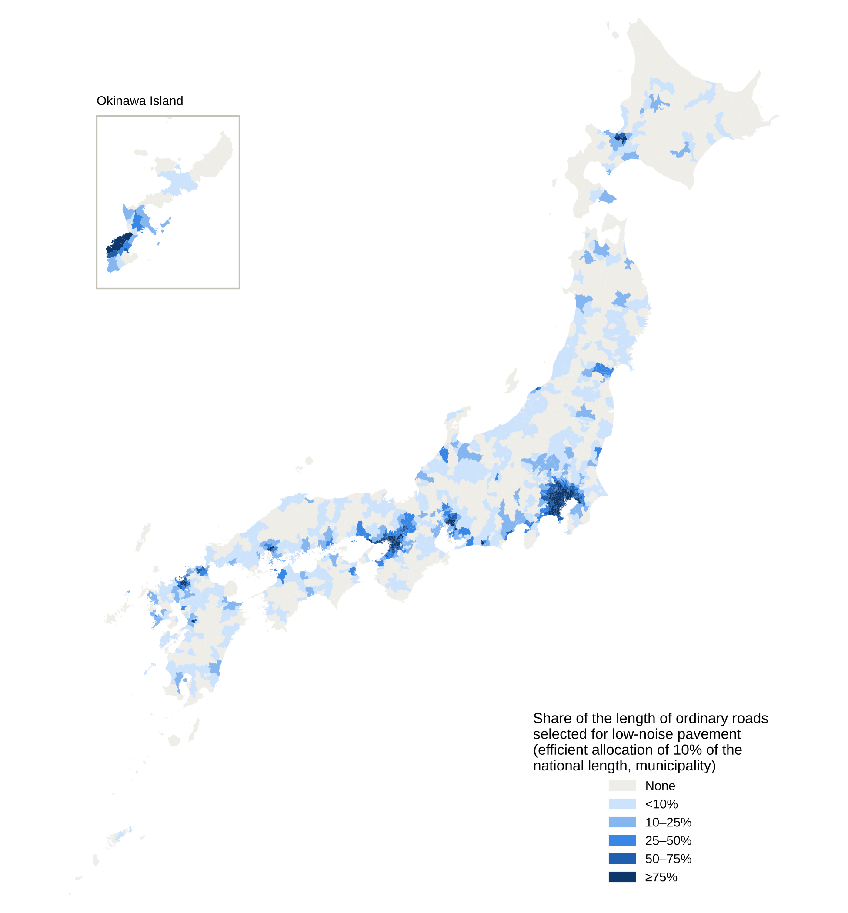

# 道路交通騒音対策の配分と睡眠便益・住宅地間の格差（日本全国）

論文「Sleep benefits and neighborhood disparities in the allocation of road traffic noise mitigation in Japan」（松下大輔、ORCID 0000-0002-6765-9366、投稿中）のコードと結果ファイルです。英語の説明は [README.md](README.md) にあります。

<p align="center"></p>

*全国の一般道の延長の10%に低騒音舗装を施工する場合に、効率配分で選ばれる区間の延長が各市区町村の一般道の延長に占める割合。拡大や指標の切り替え（睡眠妨害の超過、住宅地間の格差、公平性の重み付き配分）ができるウェブ地図：https://m138.github.io/japan-road-noise-allocation/ 。左上の枠は沖縄本島。`src/webmap/make_readme_map.py` で作成。*

限られた量の低騒音舗装をどの道路区間に施工すべきかを調べた研究です。全国の人口を代表する1,230万の受音点の夜間道路交通騒音を、一般道の交通センサス区間94,112本に結び付け、同じ施工延長を異なる方法で配分したときの睡眠妨害の削減と住宅地間の格差を比べました。公開データだけを使っています。

## 主な結果

- 夜間の道路交通騒音による高度の睡眠妨害（40 dB超過分）は成人152万人と推計される（95%区間 107万〜209万人）。自治体ごとに住宅地を借家率の順に5つに分け、全国で合算すると、借家率が最も高い住宅地の率は最も低い住宅地の1.71倍（成人1,000人あたり17.4人と10.2人）。
- 音源を3 dB下げると仮定した場合、延長あたりの削減が大きい区間から道路延長の10%に施工すると、睡眠妨害は22.1%減る。全区間に施工した場合（29.6%）の75%にあたり、無作為配分（2.9%）の7倍を超える。
- 借家率の高い住宅地での削減に重みを付けると（公平性の重み付き配分、γ = 16）、この効率配分の便益の約97%（21.5%）を保ったまま、格差の比は1.63から1.52に、絶対差は成人1,000人あたり5.2人から4.5人に下がる。借家率だけで選ぶと削減は14.1%、絶対差は4.7人。
- 区間から200 m以内の成人人口を延長で割った値の順に選ぶ簡便な基準でも、効率配分の便益の95%が得られる。

## 結果ファイル

Zenodo（https://doi.org/10.5281/zenodo.24503772 、CC BY 4.0）に次のファイルがあります。

| ファイル | 単位 | 内容 |
|---|---|---|
| `small_area_burden_2020.csv` | 2020年国勢調査の小地域（210,877地域） | 人口、借家率と自治体内5分位、地理的剥奪指標、住宅の建て方、睡眠妨害の超過人数、道路近傍NO2による死亡 |
| `section_allocation.csv` | 一般道の交通センサス区間（94,112区間） | 延長、効率配分・公平性の重み付き配分での選定の順、単独で施工した場合の便益、延長10%で選ばれる区間 |
| `source_data/` | 図と補足表のもとになる結果ファイル | このリポジトリの `data/` と同じ |

## 図と表の再現

```
pip install -r requirements.txt
python src/paper/make_figures_en.py      # figures/Fig1〜4
python src/paper/build_si_tables.py      # 補足表1〜17（src/paper/si_tables.md）
```

`data/` のファイルだけで動きます。全体の計算（受音点×区間のエネルギー行列、健康負荷、配分、感度分析、モンテカルロ）の手順、引数、乱数シードは [PIPELINE.md](PIPELINE.md)、入力データと利用条件は [DATA_SOURCES.md](DATA_SOURCES.md) にあります。暴露の推計には [japan-night-road-noise](https://github.com/m138/japan-night-road-noise) と [japan-traffic-no2](https://github.com/m138/japan-traffic-no2) を使います。

上の全国地図と `docs/` のウェブ地図は、効率配分と公平性の重み付き配分の結果を市区町村別に集計した `data/muni_allocation.csv` から、`src/webmap/` のスクリプトで作ります（手順は PIPELINE.md）。市区町村別の値は論文には載せていません。

## ライセンス

- コード：MIT License
- `data/` の結果ファイルとZenodoのデータ：CC BY 4.0。DATA_SOURCES.md の出典も表示してください。

## 引用

- Matsushita, D. Sleep benefits and neighborhood disparities in the allocation of road traffic noise mitigation in Japan: data. Zenodo https://doi.org/10.5281/zenodo.24503772 (2026).
- Matsushita, D. japan-road-noise-allocation: code for the allocation of road traffic noise mitigation in Japan (v1.0.0). Zenodo https://doi.org/10.5281/zenodo.24504209 (2026).
